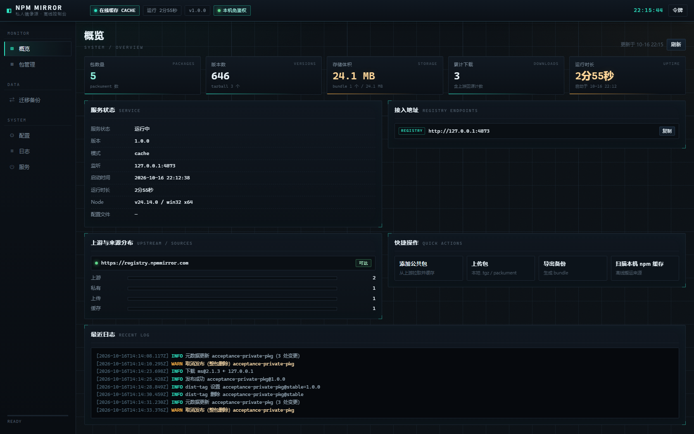

# 私人 npm 镜像源（离线版）

**零第三方依赖、可离线迁移的私人 npm 镜像源**：本地缓存公共包 + 私有包仓库 + 中文可视化管理界面 + 离线 bundle 导出导入，一个 Node.js 进程跑起来，不需要数据库、不需要构建、不需要联网安装依赖。

- 运行环境：Node.js **>= 18**（实测 Node.js 24），Windows / macOS / Linux 均可运行服务本体（一键脚本为 Windows `.cmd` / PowerShell）
- 默认地址：<http://127.0.0.1:4873>（管理界面同地址）
- 依赖数量：**0**（`dependencies` 与 `devDependencies` 均为空）
- 许可证：[MIT](LICENSE)



## 它能做什么

- **公共包缓存**：`npm install` 走本镜像时自动回源上游（默认 `https://registry.npmmirror.com`）并缓存元数据与 tarball（**支持配置多个「加速镜像源」下载 tarball**：版本元数据仍从上游源取，下载时并行探测各加速镜像，优先走「有这个版本且响应最快」的，缺版本或内容校验不通过会自动换下一个，全部不可用再回上游源，下载后同样做 integrity/shasum 校验；配置页多行输入框使用项目风格自绘拖拽角标，保存/测试前自动清理空行与每行首尾空白，并可一键「测试连通性」只读探测每个加速源的元数据与测试包 tarball（逐源显示耗时与中文原因））；支持 `cache`（本地优先）/ `proxy`（过期即回源）/ `offline`（纯离线）三种模式
- **私有包仓库**：支持 `npm publish`、`npm unpublish`、`npm deprecate`、`npm dist-tag`，私有包与上游同名包隔离，不会混淆
- **离线迁移**：导出整个镜像为单个 `.tgz` bundle，拷贝到无网络电脑后导入；也支持直接导入本机 `~/.npm/_cacache` 已有缓存。**导出选中包时默认连带递归依赖，镜像里没有的依赖会在联网模式下自动从上游下载并入库再一起打包**；下载失败不会中断导出，失败依赖会连原因一起记进 bundle 清单并在界面/命令行提示。**导出和导入都有详细进度弹窗**：一条总进度（导出按字节/文件数，导入按解包字节与包数）+ 逐包明细（已打包 / 新增 / 失败 / 跳过）+ 右栏并行进度（导出「并行文件」一行一个正在压缩的文件，导入「并行包」一行一个在导入的包），长任务可取消；**导出压缩完成后把并行分片拼成最终 `.tgz` 也有进度**（压缩阶段进度条最多停在 95%，统计行显示「正在拼接分片写入最终 .tgz：X / Y GB」、右栏标题切「正在写入 · 拼接分片」，写完再显示「正在写入 · 收尾」，49.4GB 的整机备份这段约 30~60 秒，不会再出现「100% 却不动」的错觉）。**导出还支持「按添加时间」范围**（只带走某段时间内首次添加进本地镜像的包，留空一端表示不限，时间按本机时区；起止时间点点击输入框会弹出**项目风格的自绘日历弹层**：月历 + 时/分自绘下拉 + 清除/现在/取消/确定，不是浏览器原生日历）；**导出/导入都支持多包并行**（默认 4 路，可配置），备份再导入不会因为 tarball 根目录名不叫 `package/` 而误判成坏包（`@types/*` 这类历史包也能正常导入）。**导入结束后弹窗底部会整理出一块「导入结果详情」**：失败逐条列出（`包名@版本：原因`）、跳过按原因归类计数，右上角一键复制清单，不用再去左栏一条条翻。**从本机 npm 缓存导入时会保留完整版本号**：扫描到的元数据里那些本机没有缓存 tarball 的版本只写元数据、不下载 tarball，避免导入后 packument 残缺导致后续「递归添加依赖」报「没有满足 xxx 的版本」；依赖解析发现本地元数据残缺时还会自动回源补全一次（联网 `cache`/`proxy` 模式；`offline` 模式不联网）。**导出选中包时还可以只导出指定版本**：迁移页「指定版本」多行框每行写 `包名@版本`（留空 = 全部本地版本，可一键「生成模板」列出已选包的全部版本），带依赖导出时依赖按所选版本的 `dependencies` 逐个解析出确定版本、只打包真正需要的版本——bundle 里的 `packument.json`/`meta.json` 也会裁剪成只含被导出的版本（`dist-tags.latest` 同步收敛），体积明显变小；命令行用 `--versions vue@3.4.1,react@18.2.0` 或位置参数 `包名@版本`。
- **可视化管理界面**：概览、包管理、迁移备份（含本机缓存导入）、配置、日志、服务控制共 6 个页面，中文界面，全按钮操作；包详情、依赖解析、任务进度以抽屉/弹窗呈现；**所有鼠标悬停提示都是项目风格的自绘浮层**（深色面板 + 青色强调条 + 等宽小字），不是浏览器原生 `title` 小黄框；**所有原生下拉的展开列表都换成了项目风格的自绘下拉**（触发按钮 + 深色面板、青色选中/悬停，支持鼠标、键盘 ↑↓/Enter/Esc/Tab 与点外面关闭；底层保留原生 `<select>` 语义，`value`/`change` 读写不变，动态创建/重建选项的下拉也会自动接管），搜索框的原生清除叉、数字框的原生上下箭头一并收掉，浏览器原生 `confirm` 换成项目风格确认框；**整页的动态背景（32px 网格 + 扫描线 + 光晕 + 噪点 + 9 秒扫过亮带）同样铺进每个弹窗、抽屉、面板与统计卡的内部背景**（动效层 `pointer-events:none`，不挡点击、不影响滚动）；**任务进度弹窗里的「取消」在等待取消完成期间会禁用置灰，只有取消失败才恢复可点**；**下拉按钮右侧的小箭头在悬停、键盘聚焦与展开时也会一起变成项目青色**；**复选框对勾加粗更清晰，全选「半选」态显示横杠**
- **补齐工具链**：勾选的包一键补 tarball（dist-tag / 只补最新 / 全部版本），包管理页还有三个**不用勾选**的批量入口：「全部包补 dist-tag 版本」「全部包补最新版本」「**全部包补全部版本**」（最全，把每个包所有缺失版本都补齐，确认框会先给出还要补多少个版本的估计）；递归添加依赖（含 `npm:` 别名），后台任务可看进度、可取消（进度弹窗右栏按**每个并发下载的版本**实时显示单文件字节数）；包管理列表还有**「缺 tarball / 不缺 tarball」快捷筛选**（点一下只看还没补全的包，再点一次同一个按钮取消）；补 tarball 进度弹窗左栏最多保留 500 行，超出后自动收起「已完成」的包，给还没下完的包腾位置（出错的包永远保留，顶部提示条写明已收起多少行）；导出/导入备份的进度弹窗右栏会列出**正在并行处理的项**：导出时一行一个正在压缩的文件（`包名 · tarballs/xxx.tgz` + 文件大小 +「压缩中…」，行数＝真正并发的路数，收尾阶段也不会塌成 1 行），导入时一行一个正在导入的包（已处理版本数 / 总数，一个 worker 一个包），不再只剩 1 个「当前包」
- **零依赖实现**：HTTP 服务、tar.gz 打包解包、semver 比较、npm 协议、断点与完整性校验全部手写，无任何第三方包

## 快速开始

```bash
# 1. 获取代码（本仓库不包含 data/ 运行时数据）
git clone https://github.com/SuLiyue-s/npm-mirror.git
cd npm-mirror

# 2. 初始化配置（生成 data/config.json 与访问令牌）
node cli.js init

# 3. 启动镜像源（默认 http://127.0.0.1:4873，会自动打开管理界面）
node cli.js start
```

也可以在 Windows 上直接双击 **`启动镜像源.cmd`**。服务已经在运行时再双击（或开机自启重复触发）**不会重复启动**：脚本会先执行 `node cli.js prestart` 检查——同一端口已在运行就提示「已在运行」（并自动打开管理界面）后直接结束，检测到运行在其它端口则提示先停止，不会再抢端口、也不会重复注册托盘图标。

> 首次启动后，管理界面的「配置」页与 `data/config.json` 里都能看到访问令牌（`security.token`）。

### Windows：托盘图标

双击 `启动镜像源.cmd` 后，命令行窗口会在服务就绪后自动隐藏，右下角通知区域出现**项目图标**（薄荷绿圆角方块，与网页 favicon 同一套自绘图标）：

| 操作 | 效果 |
| --- | --- |
| 左键单击托盘图标 | 打开网页端管理界面（`http://127.0.0.1:<端口>/`），不用记地址 |
| 右键 → 「打开控制台」 | 显示命令行窗口，可看日志、按 `Ctrl+C` 停止；窗口已显示时这一项换成「隐藏控制台」 |
| 右键 → 「隐藏控制台」 | 重新把命令行窗口收到后台，服务继续运行 |
| 右键 → 「打开管理界面」 | 用系统默认浏览器打开网页端管理页面（`http://127.0.0.1:<端口>/`），不用记地址 |
| 右键 → 「重启镜像源」 | 让服务自己重启：旧进程退出、新进程用相同端口与配置接管，托盘和命令行窗口都不关；改过 `data/config.json` 需要重启时最方便 |
| 右键 → 「退出镜像源」 | 停止镜像服务并关闭托盘（命令行窗口一并关闭） |

- 托盘图标可能被 Windows 收进通知区域的 **「^」溢出区**：点「^」拖到任务栏即可固定显示。
- 用的是系统自带的 Windows PowerShell，不需要额外安装任何东西；脚本在 `tools/tray.ps1`，图标由 `tools/make-icon.ps1` 自绘生成（`public/favicon.ico`）。
- 停止服务也可以双击 `停止镜像源.cmd`，托盘会在几秒内检测到服务已停止并自动退出。
- 在 Windows Terminal 里手动输入命令启动时托盘不参与（直接把窗口留着即可）；需要托盘就双击 `.cmd`。若托盘没有出现，命令行窗口会保持显示并给出提示，服务本身不受影响。

## 让项目用上这个镜像源

全局切换（会自动备份原 `~/.npmrc`，可随时还原）：

```bash
node cli.js use       # 把 npm 源切到本镜像
node cli.js unuse     # 还原为切换前的源
```

或只给单个项目配置 `.npmrc`：

```ini
registry=http://127.0.0.1:4873/
//127.0.0.1:4873/:_authToken=<你的访问令牌>
```

> 本机回环访问默认免令牌（`security.trustLocalhost: true`，覆盖整个 `127.0.0.0/8` 网段与 `::1`）；局域网共享或需要严格鉴权时，在配置里开启 `requireRead` / `requirePublish` 并分发令牌。

## 常用命令

| 命令 | 作用 |
| --- | --- |
| `node cli.js start [--port 4873] [--mode cache\|proxy\|offline] [--no-open]` | 启动服务 |
| `node cli.js stop` / `restart` / `status` / `open` | 停止 / 重启 / 查看状态 / 打开管理界面 |
| `node cli.js init` / `config [--reveal]` / `token` | 初始化配置 / 查看配置（含明文令牌）/ 显示令牌 |
| `node cli.js use [--project]` / `unuse` | 切换本机 npm 源 / 还原 |
| `node cli.js list [--q 关键字] [--source all\|upstream\|private\|upload\|cache]` | 列出本地包 |
| `node cli.js add <包名[@版本]> [--with-deps] [--depth 8] [--limit 300]` | 添加公共包（可递归依赖） |
| `node cli.js remove <包名> [--version 1.2.3] [--yes]` | 删除包或单个版本 |
| `node cli.js stats` | 统计包 / 版本 / 占用空间 |
| `node cli.js export [--scope all\|private\|upstream\|selected\|added] [--from 时间] [--to 时间] [--out 文件名] [--no-deps] [--no-fetch-deps] [--versions 包名@版本,...] [包名...]` | 导出离线 bundle（选中包默认连带依赖并自动补齐缺失依赖；`--scope added` 按首次添加时间导出，配 `--from/--to`；选中包可用 `--versions` 或位置参数 `包名@版本` 只导出指定版本，依赖按所选版本解析） |
| `node cli.js import <文件.tgz\|文件.json> [--overwrite]` | 导入离线 bundle |
| `node cli.js scan-cache [--cache 目录] [--any-registry] [--refresh]` | 扫描本机 npm 缓存 |
| `node cli.js import-cache [--all] [--overwrite] [包名...]` | 从本机 npm 缓存导入 |
| `node cli.js doctor` / `logs [--lines 100] [--level info]` | 环境自检 / 查看日志 |
| `node cli.js autostart on\|off\|status` | 开机自启（登录后隐藏启动并注册托盘图标与右键快捷菜单，写入「启动」文件夹，无需管理员） |

完整参数与界面操作见 **[使用说明.md](使用说明.md)**。

## 离线迁移流程

```bash
# 有网电脑：导出整个镜像（单个 .tgz，含全部包与元数据）
node cli.js export --scope all --out npm-mirror-all.tgz

# 只带走项目用到的包：选中包 + 递归依赖（镜像里没有的依赖会自动下载入库）
node cli.js export --scope selected --out npm-mirror-used.tgz lodash express

# 拷贝 npm-mirror-all.tgz 到无网络电脑后：
node cli.js init          # 首次使用先初始化
node cli.js start         # 启动服务
# 然后打开管理界面「迁移备份」页导入，或执行：
node cli.js import npm-mirror-all.tgz
```

> 导出选中包（`--scope selected` + 包名，或界面里勾选包后点「导出选中」）默认连带递归依赖。`cache`/`proxy` 模式下，镜像里没有的依赖会自动从上游下载并入库后再一起打包；下载失败不会中断导出，失败项会写进 bundle 清单的 `missingDeps`（带原因）和 `autoFetch` 摘要，界面与命令行都会提示。`--no-deps` 关闭连带依赖，`--no-fetch-deps` 只连带已经在本地的依赖、不自动下载。纯 `offline` 模式不会联网，只会在结果里提示缺哪些依赖。

> 导入/导出不依赖服务运行；离线机器建议把 `mode` 设为 `offline`，或把 `upstream.registry` 指向内网可达的源。

## 运行模式

| 模式 | 行为 |
| --- | --- |
| `cache`（默认） | 本地优先；本地没有或手动刷新时才回源，回源结果缓存到本地 |
| `proxy` | 元数据超过 `upstream.metadataTtlSec` 就回源更新；tarball 仍缓存 |
| `offline` | 完全离线，不回源；未缓存的内容直接 404 |

## 配置说明（`data/config.json`）

| 配置项 | 默认值 | 说明 |
| --- | --- | --- |
| `server.ip` / `server.port` | `127.0.0.1` / `4873` | 监听地址与端口 |
| `mode` | `cache` | `cache` / `proxy` / `offline` |
| `upstream.registry` | `https://registry.npmmirror.com` | 上游公共源 |
| `upstream.accelerators` | `[]` | 加速镜像源列表（最多 8 个 `http(s)://` 地址）。补 tarball 时并行探测这些镜像，优先走「有这个版本且响应最快」的，缺失/超时/校验不通过自动换下一个，全部不可用再回上游源；保存即热生效，不用重启；配置页可点「测试连通性」逐源只读探测（元数据 + 测试包 tarball，失败显示中文原因），保存时自动忽略空行与首尾空白 |
| `upstream.timeoutMs` / `retries` | `30000` / `2` | 回源超时与重试次数 |
| `upstream.metadataTtlSec` | `300` | 元数据回源缓存时长（秒） |
| `upstream.concurrency` / `maxTarballMB` | `6` / `512` | 并发下载数 / 单个 tarball 上限（MB） |
| `security.token` | 随机生成 | 访问令牌（**不要提交到仓库**） |
| `security.requirePublish` / `requireRead` | `true` / `false` | 发布 / 读取是否需要令牌 |
| `security.trustLocalhost` | `true` | 本机回环地址（整个 `127.0.0.0/8` 网段与 `::1`）免令牌 |
| `storage.dir` / `storage.maxUploadMB` | `data/storage` / `500` | 包存储目录 / 单包上传上限（MB，1-4096） |
| `storage.maxBundleUploadMB` | `4096` | 网页上传整机备份（离线包）的上限（MB，1-65536）。上传走流式落盘，不占内存；更大的包可放进 `data/bundles` 后用界面「导入」 |
| `storage.bundleExportConcurrency` | `4` | 导出整机备份时的并行压缩线程数（1-64）。整数备份大、机器核数多时可调大（高核机器可调到接近逻辑处理器数），设 1 回到单线程 |
| `storage.bundleImportConcurrency` | `4` | 导入整机备份时的总并行路数（1-64）。包多时每路各管一个包；剩余包少于路数时，空闲的路会自动抢同一个包里还没导入的版本。设 1 回到串行，机械硬盘或 CPU 忙时调小更稳 |
| `storage.bundleImportExtractConcurrency` | `8` | 离线包解包（解压 + 写盘）的并发路数（1-64）。机械硬盘上并发太高反而慢，可调低到 2-4；SSD 多核可调大到 16-32 |
| `storage.bundleUploadChunkMB` / `storage.bundleUploadConcurrency` | `8` / `4` | 网页上传离线包的分片大小（MB，1-64）与并发上传路数（1-64）。浏览器同域约 6 个连接，太大反而排队 |
| `storage.localScanConcurrency` | `8` | 本地扫描 / 统计并发（1-64）：补 tarball 前统计缺失、导出备份时统计包、依赖闭包、npm 缓存扫描 / 导入、启动时索引加载等多处本地读盘阶段共用这一路并发数。SSD 多核可调大，机械硬盘调小更稳 |
| `log.level` / `log.maxDays` | `info` / `7` | 日志级别 / 保留天数 |
| `ui.title` | `私人 npm 镜像源` | 管理界面标题 |

当前生效配置可随时在管理界面「配置」页查看与修改；令牌只能通过「重置令牌」轮换。

## 目录结构

```text
npm私人镜像源-离线版/
├─ cli.js                 命令行入口（start/stop/init/export/import/use ...）
├─ src/
│  ├─ server.js           HTTP 服务与静态页面
│  ├─ registry.js         npm registry 协议（安装/发布/取消发布/搜索/dist-tag/审计）
│  ├─ api.js              管理端 API（/__admin/api/*）
│  ├─ auth.js             令牌鉴权
│  ├─ upstream.js         上游请求（超时、重试、重定向校验、完整性校验）
│  ├─ store.js            包存储与索引（元数据 + tarball）
│  ├─ tar.js              纯 Node 实现的 tar.gz 打包 / 解包
│  ├─ bundle.js           离线 bundle 导出 / 导入
│  ├─ npmcache.js         本机 npm 缓存扫描 / 导入
│  ├─ deps.js             递归依赖解析
│  ├─ pull.js             批量补包任务
│  ├─ tasks.js            后台任务表
│  ├─ config.js           配置读写与字段校验
│  ├─ http-util.js        HTTP 工具（body/Range/静态文件/安全头）
│  ├─ logger.js           日志
│  └─ util.js             工具函数（semver、原子写、包名/版本校验等）
├─ public/                原生前端（app.js / index.html / style.css / favicon.ico）
├─ tools/                 启动器辅助脚本（tray.ps1 托盘宿主、make-icon.ps1 自绘图标）
├─ test/                  自动化测试与验收脚本
├─ data/                  运行时数据（包存储/日志/配置/离线包，已 gitignore）
├─ 使用说明.md            详细操作手册
├─ 报告.md                开发过程与验收记录
├─ 启动镜像源.cmd 等       Windows 一键脚本
└─ 截图/                  界面截图
```

## 测试与验收

先启动服务，然后：

```bash
node test/run-all.js                 # 一键自检（先探活，再跑托盘自检 + api-test）
node test/ui-check.js                # 前端静态契约检查
node test/tray-check.js              # 只跑托盘/图标/启动脚本自检（Windows）
powershell -NoProfile -ExecutionPolicy Bypass -File test/tray-e2e.ps1   # 托盘端到端（手工，需真实桌面）
pwsh -File test/acceptance-npm.ps1   # 真实 npm 客户端验收（Windows / PowerShell 7）
```

| 脚本 | 内容 | 最近结果（2026-10-18，本机） |
| --- | --- | --- |
| `test/api-test.js` | npm 协议、管理接口、发布/删除、离线导入导出、进度任务（含逐版本 `downloads[]` 实时进度）、并行导出导入与根目录/版本写法兼容、导出时自动补齐缺失依赖、全部包补全部版本规划、安全回归、包管理页「缺 tarball / 不缺 tarball」快捷筛选、**补全部包全量规划不阻塞服务（1520 包规划期间 `/-/ping` 最大延迟 < 5s、`planTargets` 改为 `mapLimit` 多路并发）、本地扫描 / 统计全并发（`storage.localScanConcurrency`：补包规划、导出统计、依赖闭包、缓存扫描导入）、`cli.js prestart` 同端口不重复启动（退出码 10/11）、回环免鉴权覆盖 127.0.0.0/8（`util.isLoopback` 与 Host: 127.0.0.5）、**统计阶段进度展示（补 tarball 规划 `phase:'plan'` 快照带「已统计 N / M 个包」、导入解包后的扫描 `phase:'scan'`、npm 缓存扫描长任务 `phase:scan/verify` 中文进度）**、**加速镜像源（`upstream.accelerators` 多源配置、`buildMirrorCandidates` 地址推导、`probeTarball` HEAD/Range 并发探测按延迟排序、`downloadTarballPreferred` 失败换源、全部失败回退上游、私有网段加速源放行与重定向限制）12 项**、**加速镜像源连通性测试 7 项（`POST /upstream/accelerators/test` 只读探测元数据与测试包 tarball、HEAD 被拒时 Range 兜底、逐源可用/不可用 + 中文原因、地址去重与校验）**等 **只导出指定版本 12 项（`versions` 白名单三种写法与非法形状 `EBADVERSION`、依赖按所选版本 `dependencies` 解析出精确版本、bundle 内 packument/meta 裁剪与 dist-tags 收敛、裁剪包可正常导入且 tarball 齐全、点名不存在版本 `EVERSIONMISSING`、非选中范围 `EBADSCOPE`、接口层 400 校验）**等 **323 项**（最近三轮新增：npm 缓存导入保留仅元数据版本 + 依赖解析强制回源补全 5 项、加速镜像源 12 项、连通性测试 7 项、只导出指定版本 12 项、接口层 versions 预规范化幂等回归 2 项） | **317 通过 + 6 跳过，0 失败** |
| `test/ui-check.js` | 前端与后端接口/页面元素契约（含导入结果的失败/跳过详情面板、导出自动补依赖勾选项、全部包补全部版本入口、补 tarball 弹窗「版本进度」栏、「缺 tarball / 不缺 tarball」快捷筛选、悬停提示自绘浮层（首页无原生 title、el() 把 title 映射成 data-tip、uiTip 控制器、`.ui-tip` 样式与项目配色变量）、补 tarball 左栏行数上限回收（`reclaimRow` 只收已完成行、失败行保留、提示条）、导出/导入进度弹窗右栏多行进度（`inFlight`：导出按「并行文件」一行一个正在压缩的条目、导入一个包一行）、导出收尾写盘阶段（`concat` 字节进度 → 任务快照 `concatDone/concatTotal` → 右栏「正在写入 · 拼接分片」，压缩阶段最多 95%）、**弹窗/抽屉/面板/统计卡内部背景复用整页动态背景（`.fx-box` 动效层 + `isolation:isolate`，与整页 32px 网格/扫过亮带一致、不挡点击）**、**导出「按添加时间」范围（segbar 与自绘日期时间选择器 `#exp-added-row`、payload `addedFrom/addedTo`、后端 `addedTimeRange` 清单、非法/空范围 400 与提示）与进度弹窗「取消」等待期禁用（`requestTaskCancel` 置灰/「正在取消…」、成功保持禁用、失败恢复可点）**、**原生下拉改项目风格自绘下拉（`csel*` 实现：7 个静态 `<select>` + 动态创建/重建选项的接管、`.csel-btn/.csel-menu` 样式、键盘与点外关闭、保留原生 `change` 语义）**、**搜索框清除叉 / 数字框上下箭头收掉、`:focus-visible` 统一青色描边、原生 `window.confirm` 换 `confirmBox`**、**下拉按钮箭头三态（悬停/键盘聚焦/展开）变青、复选框对勾加粗与全选「半选」横杠、勾选单行时表头全选框同步半选**、**概览页「上游与来源分布」条形图能真正渲染彩色填充（`fill` 用 `display:block`、非零来源最小 2% 宽）**、favicon 声明、**导入备份分片并发上传（`uploadBundleChunked` 与 `/bundles/upload/init|chunk|complete|abort` 四接口）**、**多并发解包（`extractTarGz` 并发写盘）**、**版本级并行调度器（`laneCount/stealTask/runVersionTask/laneLoop`）与右栏「· N 路」显示**、**本地扫描 / 统计全并发（九之四 8 项：`storage.localScanConcurrency` 配置页字段、规划 `mapLimit`、导出统计并发、解包后扫描并发、缓存扫描 / 导入并发、`initAsync` 启动索引并发、详情 cached 用内存索引、CLI 传并发参数）**、**并发异常点审计修复（九之五 7 项：`mapLimit` NaN 兜底与字节预算队列、`__error` 行防护、`verifyFileIntegrity` 流式校验、`putTarballFromFileAsync` 边写边算哈希、altName 拒绝 `.` / `..`、同一分片并发写保护、合并期间 abort 保护）**、**统计阶段进度展示（九之六 6 项：补包规划 `phase:'plan'` 与「已统计 N / M 个包」文案、导入扫描 `phase:scan`/`scan-done`、缓存扫描长任务、`runFill`/`runScan`/导出导入弹窗的进度分支）**、**包详情抽屉版本表表头全选/半选复选框与快捷排序（九之七 6 项：表头三态同步、本页全选/取消、排序下拉 6 种方式、切排序回第 1 页、semver 比较）**、**残缺元数据自愈（九之八 4 项：npm 缓存导入保留仅有元数据的版本号、`meta.metadataComplete` 标记、依赖解析强制回源补全一次、进度明细「N 个仅补元数据」）**、**加速镜像源（九之九 6 项：多源地址推导、HEAD/Range 探测按延迟排序、校验失败自动换源、全部失败回退上游、配置校验与热生效、托盘右键「重启镜像源」与左键打开管理界面）**、**加速镜像源输入框自绘角标与连通性测试（九之十 5 项：隐藏浏览器原生 resize 把手换成项目风格自绘斜纹角标并可指针拖动调整高度、自动清理空行与首尾空白、`POST /upstream/accelerators/test` 只读探测元数据与测试包 tarball、逐源展示可用/不可用 + 耗时 + 中文原因）**、**导出指定版本与依赖按版本解析（九之十一 5 项：迁移页「指定版本」多行框与「生成模板」、`versions` 解析进 payload、bundle 裁剪 packument/meta、接口层 `EBADVERSION/EBADSCOPE`、CLI `--versions` 与位置参数 `包名@版本`）**） | **209/209 通过** |
| `test/tray-check.js` | 托盘脚本/项目图标/启动脚本/favicon 路由契约（含右键菜单「打开管理界面」「重启镜像源」、左键单击打开管理界面、重启期间健康检查暂停）、**开机自启（`.vbs` 隐藏启动项 / UTF-16LE BOM / 旧 `.cmd` 清理 / `off` 幂等，临时目录真跑）**，并真跑一次托盘自检（Windows）、**托盘健康检查的进程存活保护（服务忙但进程还活着只提示「忙碌」、不关窗口）、启动脚本 prestart 同端口不重复启动（退出码 10/11）** | **57/57 通过** |
| `test/tray-e2e.ps1` | 托盘端到端：隔离副本启动 → 窗口隐藏 → 可重新显示 → 停服务后托盘退出并关窗 | **8/8 通过（手工）** |
| `test/acceptance-npm.ps1` | 真实 `npm install / publish / dist-tag / deprecate / unpublish` | **16/16 通过** |
| `test/ui-e2e-*.js` | 浏览器端端到端（需要 Chrome 调试端口，可选） | 需本机 Chrome CDP 环境 |

> 破坏性用例（重启服务、清空日志）默认跳过，`node test/api-test.js --destructive` 才会执行；依赖上游的 3 项自动补依赖用例在上游不可达时显式跳过（总数会随上游可达性 / 本机镜像数据状态小幅浮动，本机最近一次为 323 项、均为 0 失败）。

## 安全说明

- 默认只监听 `127.0.0.1`，仅本机可访问；映射到局域网/公网前请先阅读 **[使用说明.md](使用说明.md) 的「安全提示」**。
- 访问令牌保存在 `data/config.json`，`data/` 已列入 `.gitignore`；**提交代码前确认没有把 `data/` 或令牌带进仓库**。
- 已实现的防护：包名/版本与路径穿越校验、tarball 路由防任意文件读取、管理接口 Host/Origin 校验与令牌鉴权、常量时间令牌比较、上游重定向逐跳校验与 SSRF 防护、下载完整性校验、tar 解压上限与符号链接拦截、上传大小/格式校验、私有包不回源合并（防依赖混淆）。
- 发现安全问题请按 **[SECURITY.md](SECURITY.md)** 私下上报，不要直接开公开 issue。

## 文档

- **[使用说明.md](使用说明.md)**：安装、界面、命令行、离线迁移、局域网共享、常见问题
- **[报告.md](报告.md)**：开发过程、问题修复与验收记录
- **[CHANGELOG.md](CHANGELOG.md)**：版本变更
- **[CONTRIBUTING.md](CONTRIBUTING.md)**：参与开发与提交规范
- **[SECURITY.md](SECURITY.md)**：安全策略与漏洞上报

## 许可证

[MIT](LICENSE)，可自由使用、修改与分发。

